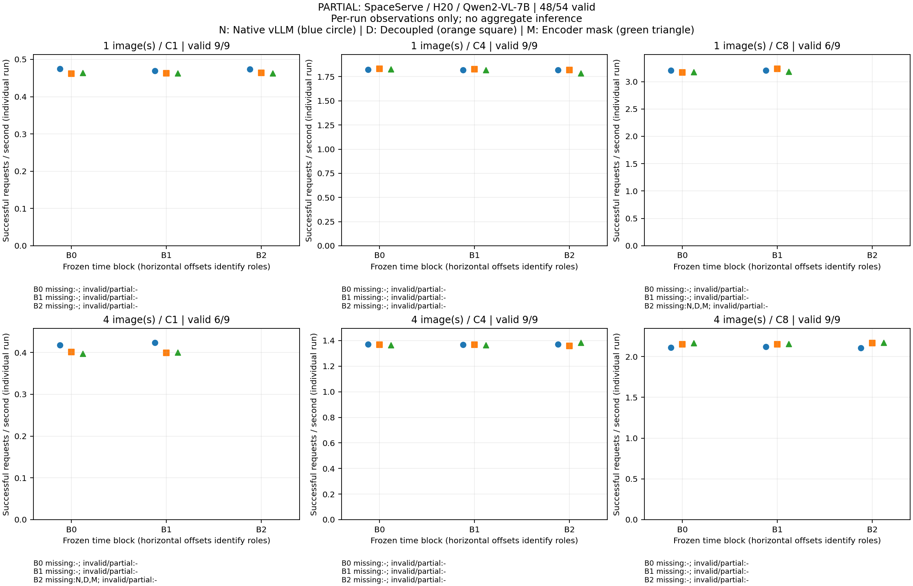
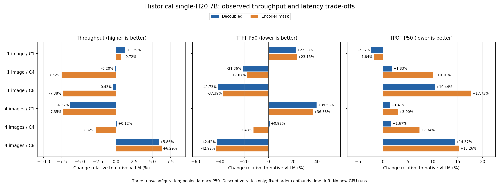
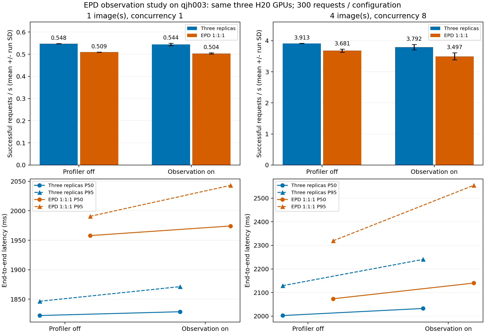

# SpaceServe 与 EPD：两个独立复现项目

本仓库分别展示两个项目的代码、baseline对照、图表和复跑方法。每个项目只与自己的同机、同模型、同GPU预算基线比较；主机、模型及批次分别列出，不作跨系统绝对排名。所有退化、失败和解释限制保留。

[English](README.en.md) · [SpaceServe项目](spaceserve/README.md) · [EPD项目](epd/README.md)

## 项目一：SpaceServe

**[进入SpaceServe独立项目页 →](spaceserve/README.md)**

Qwen2-VL-7B，单H20，对照原生vLLM；5400正式＋360预热。公开实现的解耦/并发与encoder mask已验证，完整SIS/TWSRFT及decoder互斥分区未复现。

以上及下表为已封存历史固定顺序批次。2026-10-27顺序平衡补充已按时间余量门槛停止：**48/54有效单元，4,800正式＋960预热，六项未执行**，GPU与私有MPS已释放；部分数据G4已通过；精确发布G5已通过，Release已发布并完成实际下载及首轮远端验收。

[最新补充：六负载逐区组baseline对照与三种单次吞吐比](spaceserve/README.md) · [全部延迟/显存/失败率及54项状态](outputs/spaceserve-revision-20261027/report/formal-terminal-reviewed-candidate/report.md) · [终态与限制](outputs/spaceserve-revision-20261027/report/terminal-status.md)

仅逐次描述，无总体置信区间；未完成实际顺序平衡，不与下列历史均值表合并。 [完整原件与trace下载索引（已实际下载验收）](spaceserve/REVISION_ASSETS.md)。

| 图/C | 原生vLLM | 解耦 | 解耦/原生变化 | encoder mask | mask/原生变化 |
|---|---:|---:|---:|---:|---:|
| 1/1 | 0.4457 ± 0.0002 | 0.4514 ± 0.0005 | +1.29% | 0.4489 ± 0.0006 | +0.72% |
| 1/4 | 1.7749 ± 0.0036 | 1.7713 ± 0.0141 | -0.20% | 1.6415 ± 0.0014 | -7.52% |
| 1/8 | 3.1360 ± 0.0067 | 3.1226 ± 0.0218 | -0.43% | 2.9047 ± 0.0166 | -7.38% |
| 4/1 | 0.4112 ± 0.0001 | 0.3852 ± 0.0005 | -6.32% | 0.3810 ± 0.0008 | -7.35% |
| 4/4 | 1.3313 ± 0.0033 | 1.3328 ± 0.0035 | +0.12% | 1.2937 ± 0.0112 | -2.82% |
| 4/8 | 2.0138 ± 0.0067 | 2.1318 ± 0.0114 | +5.86% | 2.1404 ± 0.0046 | +6.29% |

三次运行均值±样本SD；全部六点及负值如上，延迟P50/P95、显存、旧4090/L20结果、代码和复跑命令在独立项目页。固定执行顺序与时间漂移限制保留，不把描述性变化称为因果收益。

## 项目二：EPD Disaggregation

**[进入EPD独立项目页 →](epd/README.md)**

MiniCPM-V-2_6，EPD 1:1:1，对照同三H20上的三个完整模型副本；方案A为2400正式＋160预热。关闭请求内编码并行/角色切换，视觉token存储与迁移仍保留。

| 图/C | 三副本 req/s ± SD | EPD req/s ± SD | EPD/三副本 | TTFT P50 ms 基线→EPD | E2E P95 ms 基线→EPD |
|---|---:|---:|---:|---:|---:|
| 1/1 | 0.5479 ± 0.0009 | 0.5095 ± 0.0008 | 0.9298× | 47.40→56.60 | 1846.45→1990.70 |
| 4/8 | 3.9127 ± 0.0040 | 3.6809 ± 0.0517 | 0.9408× | 147.83→153.00 | 2129.12→2319.54 |

off主结果均无吞吐加速；高负载on观测扰动5.0027158%超旧诊断阈值，trace仅路径存在，off因果瓶颈未定位。旧双H20对照、通信诊断与离线后续在EPD页单独展示。

qjh000修正批次现已按受阻分支收口：**53/60单元，5300正式＋1060预热，七项未执行且不再续接**；实际部分G4与窄受阻G5通过，完整C未完成。lite观察预检失败，B未运行。[全部30计划baseline配对与逐次结果](outputs/epd-revision-20261026/report/C-terminal-reviewed-candidate/report.md)、[审查与失败证据](outputs/epd-revision-20261026/report/publication-status.md)、[完整原件下载与SHA256](epd/REVISION_ASSETS.md)单独保留，不与上述旧方案A汇总。缺失项不填零，不生成完整六区组CI或整体加速结论。

## 共同方法与来源

- [论文主张与本轮覆盖](PAPER_VS_REPRO.md)：已测、源码核查、未覆盖和不可比内容。
- [实际补丁审计](PATCH_AUDIT.md)、[复跑与验证状态](PORTABLE.md)、[引用与许可](CITING.md)、[第三方来源](THIRD_PARTY_NOTICES.md)。不为上游材料统一重新授权。
- [逐文件来源映射](publication/source-files.json)、[内部核查记录](publication/reviews)与[文档修正证据](docs/revision)。内部LLM审查不等同外部同行评审。
- [先前统一首页](https://github.com/BoyJiang2/spaceserve-epd-reproduction/blob/a321d3ef5fce98007e25882c88e215694903b651/README.md)保留在Git历史；原封存目录、ZIP和已有Release/tag未因展示调整而改变。

## 原始数据与证据下载

仓库及Release现已公开。Git包含可浏览报告、图表、小体积逐请求数据和代码；大trace/nsys/SQLite由完整原包保留。按项目页选择对应包，完整恢复步骤见[资产索引](publication/ASSETS.md)。权重、环境、缓存和凭据不提交。

七个完整原包：真实下载链接、大小与SHA256

## Release完整封包、大小与SHA256

已发布并验收：七个完整原包均已从GitHub实际下载，大小与SHA256逐包匹配；仓库已由用户于2026-10-26调整为public；首次发布时的private验收记录保留为历史证据。验收记录见publication/publish-state.json。

| 批次/用途 | 下载文件 | 大小（bytes / MiB） | SHA256 |
|---|---|---:|---|
| qjh000单H20/7B最终封包，含CUDA trace | [spaceserve-7b-h20.zip](https://github.com/BoyJiang2/spaceserve-epd-reproduction/releases/download/experiments-2026-10-25/spaceserve-7b-h20.zip) | 947,439,150 / 903.55 | `27101c16596d1db7e4d3f08eaf86b0456264fa370876ee813cbaace251c43eee` |
| qjh003 EPD方案A受限最终封包，含nsys/SQLite | [epd-profile-a.zip](https://github.com/BoyJiang2/spaceserve-epd-reproduction/releases/download/experiments-2026-10-25/epd-profile-a.zip) | 236,452,469 / 225.50 | `f7a35baf1c7e0e13ea1b1df65d4436efff199c5b21c876198289fbbfb2a1c094` |
| 首轮4090/L20 Space及双H20 EPD最终选用封包 | [reproduction-h20.zip](https://github.com/BoyJiang2/spaceserve-epd-reproduction/releases/download/experiments-2026-10-25/reproduction-h20.zip) | 79,894,392 / 76.19 | `3d12536a846208e3202b67650adeee2f424cc4da1bb0a6cc28c67a494941be38` |
| 首轮数据的只读后续离线分析 | [epd-followup.zip](https://github.com/BoyJiang2/spaceserve-epd-reproduction/releases/download/experiments-2026-10-25/epd-followup.zip) | 1,043,008 / 0.99 | `d155537944ea9095f2b1eecbd3780f57a611100aa9701b5e5617f4137d38a3f9` |
| 历史首版，非当前正式选用结果 | [reproduction.zip](https://github.com/BoyJiang2/spaceserve-epd-reproduction/releases/download/experiments-2026-10-25/reproduction.zip) | 67,954,214 / 64.81 | `4ca04873975832309377feaea281b71b214b9badfbae488be80eda6a43474c7d` |
| 历史待审快照，非当前正式选用结果 | [reproduction-review-pending.zip](https://github.com/BoyJiang2/spaceserve-epd-reproduction/releases/download/experiments-2026-10-25/reproduction-review-pending.zip) | 77,535,470 / 73.94 | `a661a300df154bcd0767c2dfd9a111e082e9d3f5b27b48047e4a60bfb7e4bba4` |
| 历史通信/诊断快照，非性能结论 | [reproduction-peer-diagnostic.zip](https://github.com/BoyJiang2/spaceserve-epd-reproduction/releases/download/experiments-2026-10-25/reproduction-peer-diagnostic.zip) | 69,361,661 / 66.15 | `b4b950ce36918b2a46f536f7725861cf592aa3665b0d43bc77a045909e606c25` |

