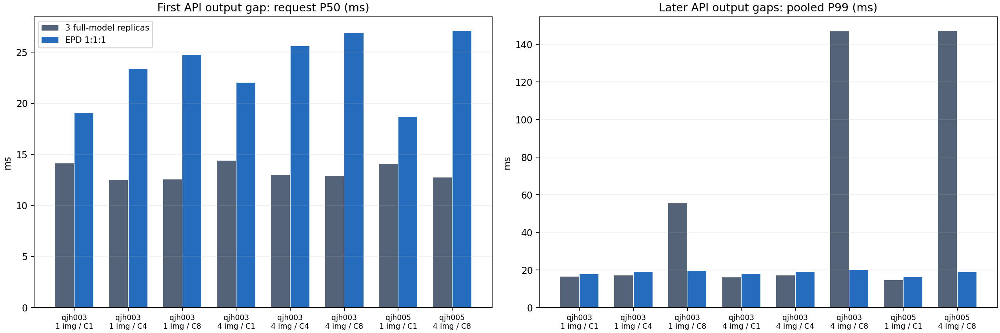
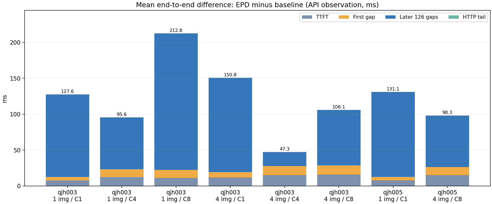

> GitHub阅读副本：仅修正链接；[封存原文](../../../../outputs/epd-followup/report.md) SHA256 6e4d2188ebb0de314a2a6a185826642ee7bde294c54a263c8e744078c989b093。原数字及解释不变。

# EPD退化：已有输出时间线能说明什么

本批只读第一轮封存数据，无新GPU实验。16个配置、4,800条正式请求全部通过旧摘要对账，旧969文件与外层ZIP的SHA在分析前后相同。G1及G2/G3已APPROVE_WITH_NITS，G4/G5现已APPROVE_WITH_NITS、BLOCKING为0；本离线批次完成。方案A范围经G1审查后已获用户明确批准，实施仍须G2。

最明确的观察：EPD不仅首个输出间隔较长，后续输出窗口也普遍更长；低负载的平均E2E差主要累积在后126个间隔。高负载下，三副本基线的间隔P99存在约147ms长尾，EPD约19–20ms；这不等于EPD总吞吐更高，也不证明长尾来自prefill干扰。

## 首间隔与后续间隔

每格300请求；首间隔P50按请求计算，后续P95/P99按300×126＝37,800个间隔合并计算。两种分位数总体不同，不能把它们直接相加或把间隔当独立重复试验。数值为基线→EPD，单位ms。

| 主机 / 图数 / 并发 | 首间隔P50 | 后续间隔P95 | 后续间隔P99 | 首末输出窗口P50 |
|---|---:|---:|---:|---:|
| qjh003 / 1 / 1 | 14.12→19.07 | 14.92→16.15 | 16.48→17.81 | 1774.3→1893.6 |
| qjh003 / 1 / 4 | 12.51→23.37 | 14.67→16.39 | 17.27→18.94 | 1700.8→1783.9 |
| qjh003 / 1 / 8 | 12.55→24.73 | 14.87→17.14 | 55.42→19.59 | 1669.4→1860.8 |
| qjh003 / 4 / 1 | 14.41→22.00 | 14.76→16.36 | 16.19→17.92 | 1772.5→1908.0 |
| qjh003 / 4 / 4 | 13.00→25.59 | 14.72→16.92 | 17.10→18.95 | 1773.4→1803.3 |
| qjh003 / 4 / 8 | 12.86→26.86 | 14.65→18.28 | 147.05→20.12 | 1855.0→1908.2 |
| qjh005 / 1 / 1 | 14.08→18.66 | 14.01→15.12 | 14.67→16.34 | 1756.8→1877.9 |
| qjh005 / 4 / 8 | 12.75→27.09 | 13.08→17.25 | 147.27→18.93 | 1837.2→1874.3 |

首间隔本身包含不同执行路径：EPD的首token由P产出，随后经KV交接进入D；基线没有相同阶段事件。这里比较的是API输出通知间隔，不是两个相同kernel的延迟。

## 平均端到端差异的算术分解

逐请求E2E＝TTFT＋首间隔＋后126间隔窗口＋HTTP尾部，因此对同样300条请求的均值可相加。下表是EPD均值减基线均值；它是观察窗口的算术分解，不能当作CPU/GPU组件耗时归因。

| 主机 / 图数 / 并发 | ΔTTFT | Δ首间隔 | Δ后126间隔窗口 | ΔHTTP尾 | ΔE2E |
|---|---:|---:|---:|---:|---:|
| qjh003 / 1 / 1 | 7.66 | 4.87 | 114.98 | 0.13 | 127.63 |
| qjh003 / 1 / 4 | 12.11 | 11.31 | 72.00 | 0.16 | 95.58 |
| qjh003 / 1 / 8 | 11.24 | 11.00 | 190.35 | 0.21 | 212.80 |
| qjh003 / 4 / 1 | 11.75 | 7.42 | 131.44 | 0.15 | 150.77 |
| qjh003 / 4 / 4 | 15.30 | 12.28 | 19.54 | 0.16 | 47.29 |
| qjh003 / 4 / 8 | 16.03 | 12.68 | 77.11 | 0.24 | 106.06 |
| qjh005 / 1 / 1 | 7.74 | 4.70 | 118.52 | 0.16 | 131.11 |
| qjh005 / 4 / 8 | 15.30 | 11.09 | 71.66 | 0.23 | 98.28 |

qjh003低负载平均E2E增加127.63ms，后126间隔合计增加114.98ms、首间隔只增加4.87ms；qjh005分别为131.11ms、118.52ms、4.70ms。它排除了“已观察到的延迟差全部集中在首交接间隔”这一简单解释，仍不能排除通信造成后续依赖、API通知、调度或GPU步效率等间接影响。两系统还包含EPDServe自带引擎与原生vLLM的实现差异，这约每后续间隔0.9ms的低负载差不能直接归于解耦本身。

EPD自身也有孤立的大间隔，部分低负载/中并发重复的最大值约209–532ms，不能把较小的池化P99理解成“EPD没有停顿”。各次重复的max与P99须一并查看。

每次100请求的重复、完整P50/P95/P99/max及按输出窗口重叠数分组的值保存在results/analysis.json；没有只保留有利重复，也未把两台主机分位数合并。并发度、真实batch及资源预算同时不同，不能靠重叠代理单独识别批量效率因果。

## 原事件的正确解释

源码及隔离CPU复现确认事件字典后写覆盖，decoding_begin的去重判断又使用了错误键类型，无法保留第一次D派发。API时间戳在消费token并await断连检查后生成；基线在vLLM异步yield后记时。两者都是服务通知观测，具体路径不同。完整源码位置与SHA见source-notes.md、source-event-excerpts.md及source/replay-manifest.json。

在本批所有2,400条EPD正式响应中，TTFT事件链均有序且完整、阶段对未见负跨度。KV调用结束均不晚于第二个API通知；这种CPU/API关系不保证真实GPU复制何时完成。数据未出现相同token时间戳，不代表已证明GPU每步恰好对应一次通知。reported_decode只作原事件描述，未作为完整解码耗时或归因依据。

后续窗口重叠数仅用同端点首末通知半开区间重建，可能包含正在迁移或排队的请求，不是GPU在执行的batch。prefill、encoding和migration事件是CPU调用/回调时刻；不据它们计算NVLink带宽、GPU利用率或调度因果。E/P等待假设本批未作结论：TTFT分段仅保存于analysis.json，尚未结合实际GPU/队列执行作解释。

## 下一步

优先按next-experiments.md的方案A，在原模型/协议下做CPU+CUDA trace与profiler关闭/开启对照，观察每步API等待、Ray提交、GPU kernel及实际copy依赖。方案B的同三卡PD候选改变资源分配且官方目录尚未验证，需另行G1/G2审查及用户确认；本批没有安装或启动它。

1图/C1来自缓存修正后的较晚会话，其他负载来自原连续矩阵；同一case内成对比较较可靠，跨负载趋势可能混入会话差异。每case只有三次100请求，300样本P95约15个尾部样本，极大间隔可能由孤立事件主导；重复详情须一并阅读。所有结论只适用于固定小模型、图片与输出长度。

复跑见README.md；原始记录留在第一轮包，新增逐请求可观测指标在results/per-request.csv，来源路径及SHA、封存前后快照均在analysis.json。本批没有修补官方事件记录路径，避免将仪表修改混入既有性能结论。
