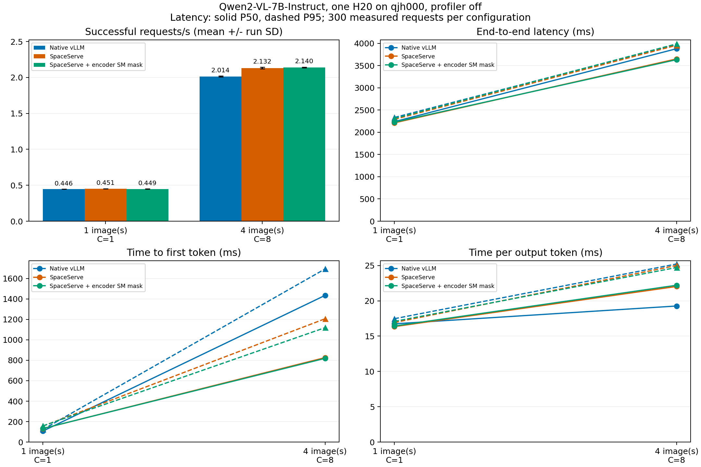

# SpaceServe 7B：qjh000 低／高两点对照

本表覆盖3组、6配置、1,800条正式请求和120条预热。GPU预算固定为同一张H20。统计由逐请求数据复算，独立审查状态见文末。



## 同机对照结果

| 组别 | 图/C | 请求/s 均值±SD | 输出tokens/s 均值±SD | TTFT P50/P95 ms | TPOT P50/P95 ms | E2E P50/P95 ms | 所有进程采样峰值GiB | 失败率 |
|---|---|---:|---:|---:|---:|---:|---:|---:|
| Native vLLM | 1/1 | 0.4457±0.0002 | 57.05±0.03 | 107.77/123.18 | 16.74/17.47 | 2238.68/2332.17 | 60.631 | 0.0% |
| SpaceServe | 1/1 | 0.4514±0.0005 | 57.78±0.06 | 131.80/156.19 | 16.35/16.92 | 2211.85/2290.65 | 63.178 | 0.0% |
| SpaceServe + encoder SM mask | 1/1 | 0.4489±0.0006 | 57.46±0.07 | 132.72/158.43 | 16.44/17.09 | 2225.88/2311.40 | 63.178 | 0.0% |
| Native vLLM | 4/8 | 2.0138±0.0067 | 257.76±0.86 | 1434.21/1692.82 | 19.27/25.22 | 3879.17/3974.69 | 62.211 | 0.0% |
| SpaceServe | 4/8 | 2.1318±0.0114 | 272.87±1.46 | 825.88/1205.65 | 22.03/25.01 | 3649.50/3956.43 | 63.570 | 0.0% |
| SpaceServe + encoder SM mask | 4/8 | 2.1404±0.0046 | 273.98±0.59 | 818.67/1118.46 | 22.21/24.72 | 3632.68/3987.63 | 63.721 | 0.0% |

| 对照组 | 图/C | 请求吞吐/原生 | 输出token IDs不同的配对数（含20预热） |
|---|---|---:|---:|
| SpaceServe | 1/1 | 1.0129× | 5/320 |
| SpaceServe | 4/8 | 1.0586× | 82/320 |
| SpaceServe + encoder SM mask | 1/1 | 1.0072× | 8/320 |
| SpaceServe + encoder SM mask | 4/8 | 1.0629× | 85/320 |

| 图/C | 启用SM掩码/不启用掩码的请求吞吐 |
|---|---:|
| 1/1 | 0.9944× |
| 4/8 | 1.0041× |

各实验组相对原生的平均吞吐比范围为1.0072–1.0629×。比值只描述本轮三次均值，不是显著性检验；差异须结合SD、延迟和采样显存一起读，不预设所有负载都加速。逐重复数值、采样覆盖及所有输出差异key保存在JSON。

首轮低／高两点的具体取舍如下；完整矩阵也保留这两个已测点，不重复采集。
1图/C1下，SpaceServe相对原生吞吐均值+1.29%；TTFT P50由107.77变为131.80ms，TPOT P50由16.74变为16.35ms。
1图/C1下，SpaceServe + encoder SM mask相对原生吞吐均值+0.72%；TTFT P50由107.77变为132.72ms，TPOT P50由16.74变为16.44ms。
同点掩码对未划分组的吞吐均值变化为-0.56%。

4图/C8下，SpaceServe相对原生吞吐均值+5.86%；TTFT P50由1434.21变为825.88ms，TPOT P50由19.27变为22.03ms。
4图/C8下，SpaceServe + encoder SM mask相对原生吞吐均值+6.29%；TTFT P50由1434.21变为818.67ms，TPOT P50由19.27变为22.21ms。
同点掩码对未划分组的吞吐均值变化为+0.41%。

高点TTFT改善同时TPOT P50变差，不能称所有延迟都改善；低点解耦组TTFT P50也高于原生。SM的额外变化很小，三次重复不构成稳定额外收益或显著性的证明。

G4复核也观察到同一实现对同一输入存在输出变化，原生高点同样如此；详见reviews/g4-points-data-subagent.md。输出差异来源未定位，不据抽查保证全量语义质量，也不称全部逐token一致。

高点掩码组E2E P95为3987.63ms，原生为3974.69ms，尾部也须与中位数一起比较。

## 设置与机制覆盖

Qwen/Qwen2-VL-7B-Instruct，FP16、TP=1、eager，最大上下文4096、最大序列数8，生成128 tokens；每配置20预热＋100正式×3。相同20张COCO RGB448×448图片、提示词、采样参数和请求序列，逐请求核对256视觉tokens/图、处理后input IDs及真实API端点。prefix与多模态预处理缓存关闭，RGB预载对齐。两个实现均有processor kwargs非keyword-only被丢弃的警告，对齐依据为实际RGB、视觉tokens和处理后IDs，不声称该kwargs已生效。

同一GPU0 UUID：`GPU-d1b595ce-0b57-cdee-c1c0-9b1051aaa07e`，驱动535.161.08；Torch2.5.1/cu124、vLLM0.7.2、transformers4.49.0。SpaceServe固定66de079af4234b27f7f82ff91d238ef1351324ba，mysmctrl固定6ff57356968a3f04158b9273aa881ee6bdf04229。全部组使用同一个100%私有MPS，正式计时关闭profiler和SM诊断，模型准备、trace导出及本项目其他负载在正式测量外完成。

cold＋restart三组共90个固定正确性案例通过，单图、多图与并发路由绑定同一原生reference。真实参数均FP16驻留同物理GPU；解耦组原始CUDA trace证明编码与语言模型执行存在重叠。SM组同PID/同实际encoder stream重复得到78→64，零mask恢复78，重新施加及首次真实编码均64；原生bit布局与实际服务二进制SHA一致。该机制仅限制编码器stream，不是decoder互斥分区或完整论文SIS，也不能将SM数量比、交叠比例当吞吐加速。

实际主模型仍含visual权重：原生/Space语言模型进程各8,291,375,616参数，解耦另驻留675,759,104参数的encoder；未将额外视觉权重从显存统计剔除。显存为worker、API和私有MPS实际GPU进程之和，逐样本核对PID、bytes求和、物理容量与采样间隙；采样峰值不等于瞬时精确峰值。MPS身份是边界快照，另有全程GPU采样，不能证明任意瞬时外来负载绝不存在。

官方分支的多图覆盖、缓存释放、进程队列兼容及设备/stream观测所需最小补丁保留在results/patches；所有先前失败尝试也保留。GPU重叠的原始自动JSON使用大epoch浮点微秒，有极小量化误差；独立G3以相对时间复算确认机制，报告不使用过多小数。

## 统计与解释边界

请求吞吐和输出tokens/s为三次实际计时窗口的算术平均±样本SD；延迟为300条正式请求合并后的inclusive线性插值P50/P95。TTFT为首个服务端token时间减客户端提交时间，未含首token回传；TPOT=(末token−首token)/127；E2E包括HTTP完成。正式结果为固定并发，不能推导真实到达率SLO。模型实现、调度和日志路径也有差异，不把全部原生/解耦差异归因为单一机制。

旧4090/L20实验为2B，qjh003 EPD使用MiniCPM与三卡预算，本批为qjh000的7B/单卡；三者分别与各自同机基线比较，不拼成跨模型或跨硬件绝对排名。EPD方案A受限交付已独立封存，见../../epd-profile-a/report/report.md。本报告不授权新增PD/DistServe或自动资源搜索。

当前能回答实现是否跑通、实际机制及表内负载下的收益/退化。显存已实测，吞吐/延迟差本身不能区分通信、CPU调度或GPU计算的因果占比；必要时应在下一轮另审最小消融。是否扩大模型应依据这些同机结果与显存余量，而不是追求论文A100倍数。

## 复算与审查

G3：APPROVE_WITH_NITS;cold+restart;effective encoder-stream SM accepted。本阶段G4：APPROVE_WITH_NITS;independent data and report scopes;BLOCKING0；交付G5：APPROVE_WITH_NITS;independent delivery review;BLOCKING0。技术audit通过不能替代独立审查，实际结论与处理见reviews/。

```bash
python3 analysis/space_results.py --root /path/to/qjh000-migration --phase points --output /path/to/qjh000-migration/report/space-points.json
python3 analysis/write_space_report.py --root /path/to/qjh000-migration --phase points
```

统计使用Python3.10标准库；绘图使用Matplotlib3.9.2、NumPy1.26.4，在本地CPU执行。原始measurement、配置、实际启动/压测脚本、GPU内存、RGB、MPS边界、模型参数及补丁保存在results/formal/。全矩阵复算还验证两点G4原bytes批准及双层SHA，原始数据不做修正或删异常。
