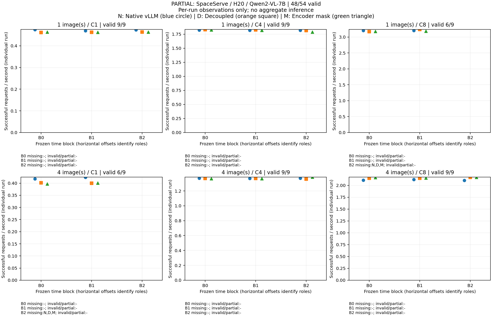

# SpaceServe H20顺序平衡补充对照

**候选报告；须实际独立G4/G5，不是实验通过或总目标完成声明。**

Qwen2-VL-7B-Instruct，单H20、FP16/TP1/eager；原生vLLM、解耦和encoder mask使用同GPU预算、私有MPS100%、固定COCO20图及同一请求序列。每cell20预热＋100正式，输出128tokens；六负载、三时间区组、54个计划单元。

完整性：**未完成或证据不足**；有效单元48/54。

[全部源SHA、逐次统计及配对区间](analysis.json)，JSON SHA256：`a0d68aff7e3b21bade5b04509290dc8dce2ac5a28711efac191f1fdb4608cb9b`。

三次时间区组是独立重复口径；100请求不当100个重复。吞吐区间使用同区组配对log比值、df2的95% Student-t；三次估计很弱，宽区间保留。三对六负载为探索比较，无多重检验后显著性宣称。冻结完整计划中负载内三位置各一次，但两两先后仍2:1；未完成批次不声称实际已实现完整位置平衡，完整批次也不能称完全先后平衡或因果收益。

## 实际退出及全局检查

控制器退出：PID 677986，exit=1；原始字段保留在analysis.json，原因不作推测。

已收集单元未发现本分析器覆盖范围内的全局冲突；这不替代G4或排除共享主机瞬态干扰。

## 全部计划单元及逐次观测

延迟为该次100正式请求P50/P95，单位ms；显存为窗内自有进程合计采样峰值GiB，可能包含MPS共享分配，不是独占物理容量。缺失不填零；失败/部分单元不作为有效性能点。

| 索引/区组/图/C/组 | 状态 | 正式/预热记录；记录失败；正式失败率 | req/s；tokens/s | TTFT P50/P95 | TPOT P50/P95 | E2E P50/P95 | 采样合计GiB |
|---|---|---:|---:|---:|---:|---:|---:|
| 0/0/4/1/space-mask | valid | 100/20；0；0.00% | 0.3973；50.85 | 455.68/503.42 | 16.18/16.86 | 2510.45/2607.96 | 63.48 |
| 1/0/4/1/baseline-space | valid | 100/20；0；0.00% | 0.4174；53.42 | 359.24/391.36 | 15.94/16.60 | 2389.65/2486.14 | 60.92 |
| 2/0/4/1/space | valid | 100/20；0；0.00% | 0.4015；51.40 | 435.56/473.26 | 16.17/16.71 | 2485.71/2566.59 | 63.48 |
| 3/0/1/8/space | valid | 100/20；0；0.00% | 3.1693；405.67 | 262.58/352.35 | 17.17/18.31 | 2424.77/2607.94 | 63.24 |
| 4/0/1/8/baseline-space | valid | 100/20；0；0.00% | 3.2023；409.90 | 450.46/469.14 | 15.65/18.33 | 2429.73/2487.30 | 61.32 |
| 5/0/1/8/space-mask | valid | 100/20；0；0.00% | 3.1757；406.48 | 281.84/411.27 | 16.98/18.03 | 2446.02/2547.30 | 63.22 |
| 6/0/4/4/space | valid | 100/20；0；0.00% | 1.3668；174.96 | 691.77/909.53 | 17.90/19.24 | 2918.59/3029.06 | 63.71 |
| 7/0/4/4/space-mask | valid | 100/20；0；0.00% | 1.3656；174.80 | 694.49/926.92 | 17.96/19.22 | 2917.37/3150.55 | 63.71 |
| 8/0/4/4/baseline-space | valid | 100/20；0；0.00% | 1.3701；175.37 | 694.06/929.03 | 17.39/20.27 | 2910.42/3005.53 | 61.84 |
| 9/0/4/8/baseline-space | valid | 100/20；0；0.00% | 2.1089；269.94 | 1435.57/1674.08 | 17.87/23.84 | 3701.65/3837.41 | 62.21 |
| 10/0/4/8/space-mask | valid | 100/20；0；0.00% | 2.1652；277.14 | 826.19/1093.51 | 21.64/24.20 | 3593.96/3820.46 | 63.56 |
| 11/0/4/8/space | valid | 100/20；0；0.00% | 2.1503；275.23 | 859.72/1191.53 | 21.54/24.47 | 3613.61/3901.95 | 63.55 |
| 12/0/1/1/space | valid | 100/20；0；0.00% | 0.4613；59.05 | 126.35/140.40 | 16.02/16.48 | 2160.63/2230.97 | 63.18 |
| 13/0/1/1/baseline-space | valid | 100/20；0；0.00% | 0.4752；60.82 | 108.18/126.02 | 15.68/16.17 | 2100.14/2165.58 | 60.63 |
| 14/0/1/1/space-mask | valid | 100/20；0；0.00% | 0.4638；59.36 | 124.41/139.02 | 15.95/16.41 | 2150.54/2205.02 | 63.18 |
| 15/0/1/4/space-mask | valid | 100/20；0；0.00% | 1.8281；234.00 | 215.64/288.39 | 15.51/16.45 | 2170.99/2260.09 | 63.22 |
| 16/0/1/4/baseline-space | valid | 100/20；0；0.00% | 1.8252；233.62 | 265.25/293.76 | 15.21/16.52 | 2187.72/2258.20 | 60.80 |
| 17/0/1/4/space | valid | 100/20；0；0.00% | 1.8332；234.65 | 207.58/275.98 | 15.51/16.30 | 2180.28/2249.86 | 63.24 |
| 18/1/1/8/baseline-space | valid | 100/20；0；0.00% | 3.2021；409.87 | 451.96/490.48 | 15.42/18.08 | 2411.06/2543.99 | 61.32 |
| 19/1/1/8/space-mask | valid | 100/20；0；0.00% | 3.1835；407.49 | 283.85/401.55 | 16.76/17.88 | 2418.06/2516.30 | 63.22 |
| 20/1/1/8/space | valid | 100/20；0；0.00% | 3.2363；414.24 | 247.52/376.57 | 16.87/17.77 | 2396.88/2509.80 | 63.24 |
| 21/1/4/4/space-mask | valid | 100/20；0；0.00% | 1.3640；174.60 | 661.42/964.63 | 17.98/19.07 | 2917.96/3092.97 | 63.71 |
| 22/1/4/4/baseline-space | valid | 100/20；0；0.00% | 1.3694；175.29 | 698.68/931.76 | 17.45/20.24 | 2919.78/2969.17 | 61.84 |
| 23/1/4/4/space | valid | 100/20；0；0.00% | 1.3676；175.05 | 696.64/905.61 | 17.74/19.31 | 2921.34/3002.08 | 63.71 |
| 24/1/4/8/space-mask | valid | 100/20；0；0.00% | 2.1580；276.23 | 835.65/1104.45 | 21.76/24.49 | 3617.99/3913.48 | 63.56 |
| 25/1/4/8/space | valid | 100/20；0；0.00% | 2.1530；275.58 | 917.32/1246.62 | 21.65/24.77 | 3618.19/3937.64 | 63.71 |
| 26/1/4/8/baseline-space | valid | 100/20；0；0.00% | 2.1224；271.67 | 1424.28/1688.85 | 17.64/23.75 | 3676.19/3765.39 | 62.21 |
| 27/1/1/1/baseline-space | valid | 100/20；0；0.00% | 0.4695；60.10 | 106.96/122.28 | 15.80/16.50 | 2117.86/2201.35 | 60.63 |
| 28/1/1/1/space-mask | valid | 100/20；0；0.00% | 0.4629；59.25 | 127.61/154.88 | 15.97/16.41 | 2157.08/2212.28 | 63.18 |
| 29/1/1/1/space | valid | 100/20；0；0.00% | 0.4630；59.26 | 127.00/152.43 | 15.94/16.50 | 2154.47/2226.54 | 63.18 |
| 30/1/1/4/baseline-space | valid | 100/20；0；0.00% | 1.8213；233.13 | 265.11/284.06 | 15.35/16.67 | 2162.91/2341.53 | 60.80 |
| 31/1/1/4/space | valid | 100/20；0；0.00% | 1.8281；233.99 | 222.91/295.53 | 15.46/16.30 | 2194.61/2251.99 | 63.22 |
| 32/1/1/4/space-mask | valid | 100/20；0；0.00% | 1.8188；232.80 | 223.67/300.50 | 15.52/16.45 | 2192.52/2256.26 | 63.22 |
| 33/1/4/1/baseline-space | valid | 100/20；0；0.00% | 0.4237；54.23 | 343.18/373.10 | 15.81/16.36 | 2355.79/2421.46 | 60.92 |
| 34/1/4/1/space | valid | 100/20；0；0.00% | 0.3994；51.12 | 443.34/518.04 | 16.11/16.61 | 2499.78/2569.58 | 63.48 |
| 35/1/4/1/space-mask | valid | 100/20；0；0.00% | 0.4002；51.22 | 447.85/492.28 | 16.13/16.59 | 2489.52/2560.00 | 63.48 |
| 36/2/4/4/baseline-space | valid | 100/20；0；0.00% | 1.3704；175.42 | 695.35/928.44 | 17.36/20.34 | 2913.68/2990.81 | 61.84 |
| 37/2/4/4/space | valid | 100/20；0；0.00% | 1.3584；173.87 | 660.63/914.29 | 18.06/19.16 | 2940.46/3018.83 | 63.71 |
| 38/2/4/4/space-mask | valid | 100/20；0；0.00% | 1.3846；177.23 | 624.36/850.61 | 17.83/19.07 | 2878.79/3050.62 | 63.64 |
| 39/2/4/8/space | valid | 100/20；0；0.00% | 2.1682；277.53 | 871.06/1217.24 | 21.33/24.15 | 3588.92/3869.40 | 63.71 |
| 40/2/4/8/baseline-space | valid | 100/20；0；0.00% | 2.1057；269.53 | 1435.93/1699.77 | 17.87/23.77 | 3690.91/3812.66 | 62.21 |
| 41/2/4/8/space-mask | valid | 100/20；0；0.00% | 2.1718；277.99 | 832.34/1105.63 | 21.73/24.43 | 3585.20/3920.72 | 63.71 |
| 42/2/1/1/space-mask | valid | 100/20；0；0.00% | 0.4632；59.29 | 130.03/149.30 | 15.92/16.58 | 2157.49/2238.23 | 63.18 |
| 43/2/1/1/space | valid | 100/20；0；0.00% | 0.4636；59.34 | 125.87/151.94 | 15.89/16.48 | 2143.11/2220.73 | 63.18 |
| 44/2/1/1/baseline-space | valid | 100/20；0；0.00% | 0.4741；60.69 | 107.74/117.96 | 15.68/16.21 | 2101.75/2173.49 | 60.63 |
| 45/2/1/4/space | valid | 100/20；0；0.00% | 1.8176；232.66 | 209.53/280.50 | 15.65/16.57 | 2185.85/2277.58 | 63.22 |
| 46/2/1/4/space-mask | valid | 100/20；0；0.00% | 1.7876；228.82 | 219.42/291.39 | 15.88/16.72 | 2227.90/2311.61 | 63.22 |
| 47/2/1/4/baseline-space | valid | 100/20；0；0.00% | 1.8183；232.75 | 266.15/281.31 | 15.18/16.73 | 2182.45/2287.32 | 60.80 |
| 48/2/4/1/space | missing | 未知/未知；未知；未知 | — | — | — | — | — |
| 49/2/4/1/space-mask | missing | 未知/未知；未知；未知 | — | — | — | — | — |
| 50/2/4/1/baseline-space | missing | 未知/未知；未知；未知 | — | — | — | — | — |
| 51/2/1/8/space-mask | missing | 未知/未知；未知；未知 | — | — | — | — | — |
| 52/2/1/8/space | missing | 未知/未知；未知；未知 | — | — | — | — | — |
| 53/2/1/8/baseline-space | missing | 未知/未知；未知；未知 | — | — | — | — | — |

## 全部54项计划配对

只列同区组有效双方的单次吞吐比；有全局冲突则全部禁比值。单次比值不代表三次总体收益。

| 区组/图/C | 目标/分母 | 双方状态 | 单次吞吐比 |
|---|---|---|---:|
| 0/1/1 | space/baseline-space | valid/valid | 0.9708 |
| 1/1/1 | space/baseline-space | valid/valid | 0.9861 |
| 2/1/1 | space/baseline-space | valid/valid | 0.9778 |
| 0/1/1 | space-mask/baseline-space | valid/valid | 0.9761 |
| 1/1/1 | space-mask/baseline-space | valid/valid | 0.9859 |
| 2/1/1 | space-mask/baseline-space | valid/valid | 0.9770 |
| 0/1/1 | space-mask/space | valid/valid | 1.0054 |
| 1/1/1 | space-mask/space | valid/valid | 0.9998 |
| 2/1/1 | space-mask/space | valid/valid | 0.9993 |
| 0/1/4 | space/baseline-space | valid/valid | 1.0044 |
| 1/1/4 | space/baseline-space | valid/valid | 1.0037 |
| 2/1/4 | space/baseline-space | valid/valid | 0.9996 |
| 0/1/4 | space-mask/baseline-space | valid/valid | 1.0016 |
| 1/1/4 | space-mask/baseline-space | valid/valid | 0.9986 |
| 2/1/4 | space-mask/baseline-space | valid/valid | 0.9831 |
| 0/1/4 | space-mask/space | valid/valid | 0.9972 |
| 1/1/4 | space-mask/space | valid/valid | 0.9949 |
| 2/1/4 | space-mask/space | valid/valid | 0.9835 |
| 0/1/8 | space/baseline-space | valid/valid | 0.9897 |
| 1/1/8 | space/baseline-space | valid/valid | 1.0107 |
| 2/1/8 | space/baseline-space | missing/missing | 未知 |
| 0/1/8 | space-mask/baseline-space | valid/valid | 0.9917 |
| 1/1/8 | space-mask/baseline-space | valid/valid | 0.9942 |
| 2/1/8 | space-mask/baseline-space | missing/missing | 未知 |
| 0/1/8 | space-mask/space | valid/valid | 1.0020 |
| 1/1/8 | space-mask/space | valid/valid | 0.9837 |
| 2/1/8 | space-mask/space | missing/missing | 未知 |
| 0/4/1 | space/baseline-space | valid/valid | 0.9621 |
| 1/4/1 | space/baseline-space | valid/valid | 0.9427 |
| 2/4/1 | space/baseline-space | missing/missing | 未知 |
| 0/4/1 | space-mask/baseline-space | valid/valid | 0.9519 |
| 1/4/1 | space-mask/baseline-space | valid/valid | 0.9445 |
| 2/4/1 | space-mask/baseline-space | missing/missing | 未知 |
| 0/4/1 | space-mask/space | valid/valid | 0.9894 |
| 1/4/1 | space-mask/space | valid/valid | 1.0019 |
| 2/4/1 | space-mask/space | missing/missing | 未知 |
| 0/4/4 | space/baseline-space | valid/valid | 0.9976 |
| 1/4/4 | space/baseline-space | valid/valid | 0.9986 |
| 2/4/4 | space/baseline-space | valid/valid | 0.9912 |
| 0/4/4 | space-mask/baseline-space | valid/valid | 0.9967 |
| 1/4/4 | space-mask/baseline-space | valid/valid | 0.9961 |
| 2/4/4 | space-mask/baseline-space | valid/valid | 1.0103 |
| 0/4/4 | space-mask/space | valid/valid | 0.9991 |
| 1/4/4 | space-mask/space | valid/valid | 0.9974 |
| 2/4/4 | space-mask/space | valid/valid | 1.0193 |
| 0/4/8 | space/baseline-space | valid/valid | 1.0196 |
| 1/4/8 | space/baseline-space | valid/valid | 1.0144 |
| 2/4/8 | space/baseline-space | valid/valid | 1.0297 |
| 0/4/8 | space-mask/baseline-space | valid/valid | 1.0267 |
| 1/4/8 | space-mask/baseline-space | valid/valid | 1.0168 |
| 2/4/8 | space-mask/baseline-space | valid/valid | 1.0314 |
| 0/4/8 | space-mask/space | valid/valid | 1.0069 |
| 1/4/8 | space-mask/space | valid/valid | 1.0023 |
| 2/4/8 | space-mask/space | valid/valid | 1.0017 |

**不生成完整矩阵性能图、合并区间或总体加速结论。** 保留全部计划项和逐次原件，后续仅按有效预约与新审查处理断点。

### 逐次原始观察（不是总体结论）

下图只展示本批有效单次运行，全部六负载、三组及缺失/失败状态同时呈现；没有均值、拟合或置信区间。点的水平偏移只区分组，不代表真实经过时长。完整位置平衡是冻结计划，未完成批次不声称已实际达成。

## 机制覆盖与解释限制

实际预检已验证encoder真实stream的mask撤销/重施；正式组关闭profiler和SM探针。加载库不等于decoder应用mask；没有decoder互斥分区、SM数量对应吞吐份额或完整论文调度复现结论。

min/max pixels=200704参数被vLLM忽略，实际输入448×448、每图256视觉token。解耦decoder仍保留visual与language参数，另有独立visual encoder，不能称language-only。预检trace不用于反推formal off关键路径。

共享主机快照会遗漏瞬态干扰；固定并发不等于到达率SLO，未测极限容量。本批与历史4090/L20/H20结果分开，所有退化保留，不作跨硬件绝对排名。
