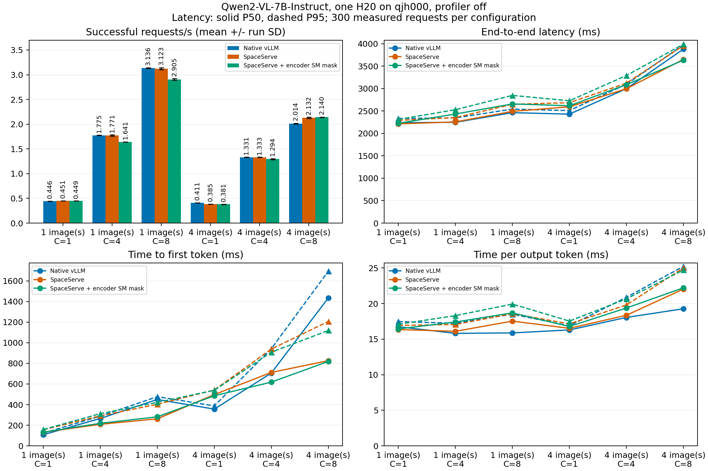

# SpaceServe 复现项目

当前 [qjh003 固定目录代码与迁移状态](migration/README.md)：Space源码G2通过，尚待发布/目标部署与实际验证，没有新性能结果。

## 新窗口机制预检：313 请求通过，正式 0/54

2026-10-27 13:00 窗口已完成独立的 native、解耦、有效 encoder mask 模型与机制预检，模型 G3 和预检报告 G4 通过；正式测量未启动，没有新性能比值。详见[本批可读报告、原始数据、版本与证据包状态](preflight-20261027-1300/README.md)。旧 48/54 及下方历史 baseline 对照独立保留。

## 顺序平衡补充批次：48/54 部分结果（部分数据G4通过）

单H20、Qwen2-VL-7B-Instruct、FP16/TP1/eager，三组共用私有MPS100%、同一COCO20图和请求序列；每单元20预热＋100正式、128输出tokens。已产生4,800正式＋960预热，六项未执行。完整54单元的顺序平衡目标尚未达成；不与下方历史固定顺序批次合并。

下表为每个时间区组的单次成功吞吐req/s，三种比值均在同区组、同负载内计算。**不是跨运行平均值、置信区间或总体加速结论**；缺失不填零，退化保留。原生为N，解耦为D，有效encoder mask为M。

| 图/C | 区组 | N req/s | D req/s | M req/s | D/N | M/N | M/D |
|---|---:|---:|---:|---:|---:|---:|---:|
| 1/1 | B0 | 0.4752 | 0.4613 | 0.4638 | 0.9708× | 0.9761× | 1.0054× |
| 1/1 | B1 | 0.4695 | 0.4630 | 0.4629 | 0.9861× | 0.9859× | 0.9998× |
| 1/1 | B2 | 0.4741 | 0.4636 | 0.4632 | 0.9778× | 0.9770× | 0.9993× |
| 1/4 | B0 | 1.8252 | 1.8332 | 1.8281 | 1.0044× | 1.0016× | 0.9972× |
| 1/4 | B1 | 1.8213 | 1.8281 | 1.8188 | 1.0037× | 0.9986× | 0.9949× |
| 1/4 | B2 | 1.8183 | 1.8176 | 1.7876 | 0.9996× | 0.9831× | 0.9835× |
| 1/8 | B0 | 3.2023 | 3.1693 | 3.1757 | 0.9897× | 0.9917× | 1.0020× |
| 1/8 | B1 | 3.2021 | 3.2363 | 3.1835 | 1.0107× | 0.9942× | 0.9837× |
| 1/8 | B2 | 未执行 | 未执行 | 未执行 | — | — | — |
| 4/1 | B0 | 0.4174 | 0.4015 | 0.3973 | 0.9621× | 0.9519× | 0.9894× |
| 4/1 | B1 | 0.4237 | 0.3994 | 0.4002 | 0.9427× | 0.9445× | 1.0019× |
| 4/1 | B2 | 未执行 | 未执行 | 未执行 | — | — | — |
| 4/4 | B0 | 1.3701 | 1.3668 | 1.3656 | 0.9976× | 0.9967× | 0.9991× |
| 4/4 | B1 | 1.3694 | 1.3676 | 1.3640 | 0.9986× | 0.9961× | 0.9974× |
| 4/4 | B2 | 1.3704 | 1.3584 | 1.3846 | 0.9912× | 1.0103× | 1.0193× |
| 4/8 | B0 | 2.1089 | 2.1503 | 2.1652 | 1.0196× | 1.0267× | 1.0069× |
| 4/8 | B1 | 2.1224 | 2.1530 | 2.1580 | 1.0144× | 1.0168× | 1.0023× |
| 4/8 | B2 | 2.1057 | 2.1682 | 2.1718 | 1.0297× | 1.0314× | 1.0017× |


每次输出tokens/s、TTFT/TPOT/E2E P50/P95、采样显存、失败率及完整54计划状态见[逐次完整报告](../outputs/spaceserve-revision-20261027/report/formal-terminal-reviewed-candidate/report.md)和[逐请求原件](../outputs/spaceserve-revision-20261027/results/formal)。当前48个有效单元均为100正式成功请求；六个缺项是未执行，不作为失败率的零分母或性能点。

终态日志在第048单元服务启动前触发原900秒余量门槛，controller exit1，未缩请求或重采；[终态与下载证据](../outputs/spaceserve-revision-20261027/report/terminal-status.md)及[释放复核](../outputs/spaceserve-revision-20261027/evidence/post-reservation-release-check.json)分别保留。所有GPU工作已停止。

模型313正确性/诊断预检与实际encoder stream撤销/重施mask通过独立G3；这不证明decoder互斥分区、完整论文调度或off因果瓶颈。decoder仍驻留visual与language参数，另有独立encoder。200704像素参数被vLLM忽略，实际图片448×448/每图256视觉tokens。共享主机瞬态干扰、三次小样本及未完成顺序平衡限制保留。

[本批版本、源码与配置映射](../outputs/spaceserve-revision-20261027/configs/executed-model-config-map.md) · [补丁和复跑步骤](../outputs/spaceserve-revision-20261027/patches/README.md) · [实际启动/压测代码](../outputs/spaceserve-revision-20261027/scripts) · [CPU离线复算](../outputs/spaceserve-revision-20261027/analysis)

完整包恢复后可用 `python -B analysis/render_report.py --root /absolute/path/copied-batch --output /absolute/path/new-report` 重新审计；输出拒覆盖。新GPU窗口必须重新核资源身份并经相应审查，历史批准不构成运行许可。


[本项目baseline完整对照](comparison/README.md) · [实际代码](code) · [版本配置](configs) · [补丁](patches) · [原始数据与证据](data/README.md) · [源文件SHA映射](SOURCE_FILES.json)


[返回项目总入口](../README.md) · [English overview](../README.en.md#spaceserve) · [论文覆盖](../PAPER_VS_REPRO.md) · [补丁审计](../PATCH_AUDIT.md)

本项目研究同卡编码器与语言模型的解耦、并发及encoder stream SM mask。历史基准批次为qjh000单H20、Qwen2-VL-7B-Instruct、FP16/TP1/eager，3组18配置、5400正式＋360预热；旧4090/L20、2B结果另列。

仅覆盖固定公开实现子集，未复现完整SIS/TWSRFT或decoder互斥分区。LM仍保留visual权重，另有encoder驻留；所有自有GPU进程显存合计计入。本页全部性能对照属于SpaceServe，不与EPD的三卡预算或模型作绝对排名。

[本批完整原件、trace下载及SHA（已发布验收）](REVISION_ASSETS.md) · [实际部分G4与终态审查](../outputs/spaceserve-revision-20261027/report/publication-status.md)

## 历史固定顺序批次：直接与原生vLLM比较

同qjh000单H20、7B、同请求序列。吞吐为三重复均值±样本SD（req/s）；比值用未四舍五入均值计算。

| 图/C | 原生vLLM | 解耦 | 解耦/原生变化 | encoder mask | mask/原生变化 |
|---|---:|---:|---:|---:|---:|
| 1/1 | 0.4457 ± 0.0002 | 0.4514 ± 0.0005 | +1.29% | 0.4489 ± 0.0006 | +0.72% |
| 1/4 | 1.7749 ± 0.0036 | 1.7713 ± 0.0141 | -0.20% | 1.6415 ± 0.0014 | -7.52% |
| 1/8 | 3.1360 ± 0.0067 | 3.1226 ± 0.0218 | -0.43% | 2.9047 ± 0.0166 | -7.38% |
| 4/1 | 0.4112 ± 0.0001 | 0.3852 ± 0.0005 | -6.32% | 0.3810 ± 0.0008 | -7.35% |
| 4/4 | 1.3313 ± 0.0033 | 1.3328 ± 0.0035 | +0.12% | 1.2937 ± 0.0112 | -2.82% |
| 4/8 | 2.0138 ± 0.0067 | 2.1318 ± 0.0114 | +5.86% | 2.1404 ± 0.0046 | +6.29% |

延迟不能只看吞吐。下表为TTFT / TPOT P50（ms），P50合并300条正式请求计算；TTFT为服务端首token时间减客户端提交时间，不含首token回传。E2E P50/P95和采样显存完整保留于报告。

| 图/C | 原生 TTFT / TPOT | 解耦 TTFT / TPOT | mask TTFT / TPOT |
|---|---:|---:|---:|
| 1/1 | 107.77 / 16.74 | 131.80 / 16.35 | 132.72 / 16.44 |
| 1/4 | 265.99 / 15.81 | 209.18 / 16.10 | 218.99 / 17.41 |
| 1/8 | 449.86 / 15.88 | 262.13 / 17.53 | 281.65 / 18.69 |
| 4/1 | 356.43 / 16.29 | 497.32 / 16.52 | 485.93 / 16.78 |
| 4/4 | 705.58 / 18.05 | 712.08 / 18.35 | 617.89 / 19.37 |
| 4/8 | 1434.21 / 19.27 | 825.88 / 22.03 | 818.67 / 22.21 |

### 单H20/7B：端到端延迟与显存并列

E2E为300正式请求合并P50/P95（ms）；显存为所有自有GPU进程采样合计峰值GiB，包括额外encoder及LM驻留visual权重，不能称论文E-worker容量或连续精确峰值。

| 图/C | 原生E2E P50/P95 | 解耦E2E P50/P95 | mask E2E P50/P95 | 原生GiB | 解耦GiB | mask GiB |
|---|---:|---:|---:|---:|---:|---:|
| 1/1 | 2238.68/2332.17 | 2211.85/2290.65 | 2225.88/2311.40 | 60.63 | 63.18 | 63.18 |
| 1/4 | 2246.21/2345.39 | 2255.76/2352.26 | 2431.32/2527.76 | 60.80 | 63.22 | 63.22 |
| 1/8 | 2462.23/2541.16 | 2490.90/2648.44 | 2656.32/2847.08 | 61.39 | 63.27 | 63.22 |
| 4/1 | 2429.17/2509.27 | 2592.98/2684.55 | 2616.07/2727.09 | 61.39 | 63.57 | 63.53 |
| 4/4 | 2996.43/3094.28 | 2994.79/3119.27 | 3086.39/3289.70 | 61.62 | 63.65 | 63.53 |
| 4/8 | 3879.17/3974.69 | 3649.50/3956.43 | 3632.68/3987.63 | 62.21 | 63.57 | 63.72 |

来源：[已封存完整统计与各重复](../outputs/qjh000-migration/report/space-all.json)。固定顺序/三重复的历史限制保持；顺序平衡补充批次见上方独立部分结果，不与本表合并。

### 观察到的指标权衡


百分比为`100×(实验组/原生−1)`，吞吐越高越好，延迟越低越好。吞吐使用三次运行均值，TTFT/TPOT使用300正式请求合并P50；图中没有将请求当独立运行计算置信区间。三次运行值、样本SD和37项源SHA见[派生数据](../docs/revision/space-relative.json)，[CPU重算入口](../scripts/revision/compare_existing_space.py)验证原始记录与封存统计一致。4图/C8解耦组表现为TTFT降低42.42%、TPOT增加14.37%、吞吐增加5.86%，是观察到的权衡，不是排队时间转移的证明。固定顺序与时间漂移限制保留。

## 历史4090/L20：各自与原生vLLM比较

以下沿用首轮报告原表：tokens/s为128输出token条件下三次运行均值±样本SD。每配置20请求预热，100正式请求重复三次；与最新7B/H20批次分开展示。

### sapphire1，Qwen2-VL-2B，单4090原生 vs 解耦

| 图数 / 并发 | 基线 tokens/s | 目标 tokens/s | 吞吐比 | TTFT P95 ms：基线→目标 | TPOT P95 ms：基线→目标 | E2E P95 ms：基线→目标 |
|---|---:|---:|---:|---:|---:|---:|
| 1 / 1 | 69.8 ± 0.5 | 68.3 ± 1.1 | 0.98× | 90.1→106.0 | 17.01→16.92 | 2240.2→2243.8 |
| 1 / 4 | 252.7 ± 10.1 | 262.2 ± 5.2 | 1.04× | 158.9→114.2 | 18.05→17.42 | 2424.6→2304.3 |
| 1 / 8 | 462.6 ± 12.5 | 477.2 ± 6.1 | 1.03× | 253.1→187.7 | 18.48→18.15 | 2530.8→2420.7 |
| 4 / 1 | 60.4 ± 0.3 | 55.5 ± 0.6 | 0.92× | 384.0→590.7 | 17.00→16.90 | 2509.0→2690.0 |
| 4 / 4 | 189.9 ± 1.5 | 191.9 ± 2.7 | 1.01× | 717.5→675.4 | 20.10→19.12 | 3086.0→2910.7 |
| 4 / 8 | 308.3 ± 4.9 | 331.4 ± 5.3 | 1.08× | 1250.2→2146.5 | 23.49→21.13 | 3742.7→3517.6 |

### sapphire3，Qwen2-VL-2B，单L20原生 vs 解耦

| 图数 / 并发 | 基线 tokens/s | 目标 tokens/s | 吞吐比 | TTFT P95 ms：基线→目标 | TPOT P95 ms：基线→目标 | E2E P95 ms：基线→目标 |
|---|---:|---:|---:|---:|---:|---:|
| 1 / 1 | 72.8 ± 0.4 | 73.9 ± 3.0 | 1.01× | 78.0→97.6 | 15.40→15.05 | 2029.4→2006.5 |
| 4 / 8 | 315.8 ± 3.4 | 394.9 ± 8.1 | 1.25× | 1333.3→1977.8 | 21.57→17.19 | 3735.4→3098.3 |

### sapphire3，Qwen2-VL-2B，单L20原生 vs encoder mask

| 图数 / 并发 | 基线 tokens/s | 目标 tokens/s | 吞吐比 | TTFT P95 ms：基线→目标 | TPOT P95 ms：基线→目标 | E2E P95 ms：基线→目标 |
|---|---:|---:|---:|---:|---:|---:|
| 1 / 1 | 72.8 ± 0.4 | 83.8 ± 0.4 | 1.15× | 78.0→91.9 | 15.40→12.45 | 2029.4→1674.5 |
| 4 / 8 | 315.8 ± 3.4 | 411.7 ± 12.9 | 1.30× | 1333.3→1696.7 | 21.57→17.30 | 3735.4→2939.0 |

L20仅低/高两点；4090当前库/驱动拒绝SM mask，不宣称划分成功。


## 完整图表与机制限制



encoder stream SM实测78→64，可清零恢复并重新施加；原trace记录编码与语言CUDA活动重叠。这不等于完整互斥分区，也不保证吞吐提高。部分输出token IDs不同，输入相同不代表全部逐token或语义等价。三重复、固定顺序与时间漂移限制保留，不将描述性百分比当显著性或因果结论。

## 代码、报告与复跑

| 内容 | 入口 |
|---|---|
| 最新结论/完整统计 | [结论](../docs/reading/outputs/qjh000-migration/report/final-summary.md) / [六点报告](../docs/reading/outputs/qjh000-migration/report/space-all-report.md) |
| 启动、压测和分析 | [scripts](../outputs/qjh000-migration/scripts) / [analysis](../outputs/qjh000-migration/analysis) / [实际脚本](../outputs/qjh000-migration/results/formal/used-scripts) |
| 版本、权重pin及补丁 | [configs](../outputs/qjh000-migration/configs) / [累计补丁](../outputs/qjh000-migration/results/patches) |
| 逐请求与机制证据 | [正式数据](../outputs/qjh000-migration/results/formal) / [机制入口](../docs/reading/outputs/qjh000-migration/README.md) |
| 4090/L20历史批次 | [阶段报告](../docs/reading/outputs/reproduction/report/sapphire-stage-report.md) / [旧配置](../outputs/reproduction/configs) / [旧补丁](../outputs/reproduction/patches) |

以下CPU命令在仓库根目录执行，需Matplotlib3.9.2，不运行GPU，不改原始数据：

```bash
python scripts/revision/compare_existing_space.py
```

恢复完整证据后，也可在副本重算原始Space统计（不覆盖封存统计）：

```bash
mkdir -p restore/recomputed
python restore/outputs/qjh000-migration/analysis/space_results.py --root restore/outputs/qjh000-migration --phase all --output restore/recomputed/space-all.json
```

GPU复跑按[原命令与前提](../docs/reading/outputs/qjh000-migration/README.md)和[可移植状态](../PORTABLE.md)：context4096、1/4图、C1/4/8，native/解耦/encoder mask同卡、相同私有MPS与缓存条件。原路径、UUID、boot、锁和审查marker不能直接删除；新主机必须重新验证。旧2B安装路径不是最新7B配置。

## 完整证据下载

[Release](https://github.com/BoyJiang2/spaceserve-epd-reproduction/releases/tag/experiments-2026-10-25)保留原完整ZIP；最新Space包与首轮共享包如下。共享包同时含EPD材料，按Space来源路径取用；其余历史包和完整恢复步骤见[资产索引](../publication/ASSETS.md)。

| 批次/用途 | 下载文件 | 大小（bytes / MiB） | SHA256 |
|---|---|---:|---|
| qjh000单H20/7B最终封包，含CUDA trace | [spaceserve-7b-h20.zip](https://github.com/BoyJiang2/spaceserve-epd-reproduction/releases/download/experiments-2026-10-25/spaceserve-7b-h20.zip) | 947,439,150 / 903.55 | `27101c16596d1db7e4d3f08eaf86b0456264fa370876ee813cbaace251c43eee` |
| 首轮4090/L20 Space及双H20 EPD最终选用封包 | [reproduction-h20.zip](https://github.com/BoyJiang2/spaceserve-epd-reproduction/releases/download/experiments-2026-10-25/reproduction-h20.zip) | 79,894,392 / 76.19 | `3d12536a846208e3202b67650adeee2f424cc4da1bb0a6cc28c67a494941be38` |

[2026-10-28 夜间窗口 CPU 准备](preparation-20261028-2300/README.md)：12 项 staging 用例通过，约23.74 GB冻结输入独立复制校验完成；GPU尚未启动、正式0/54，未产生新性能结论。
